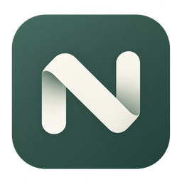
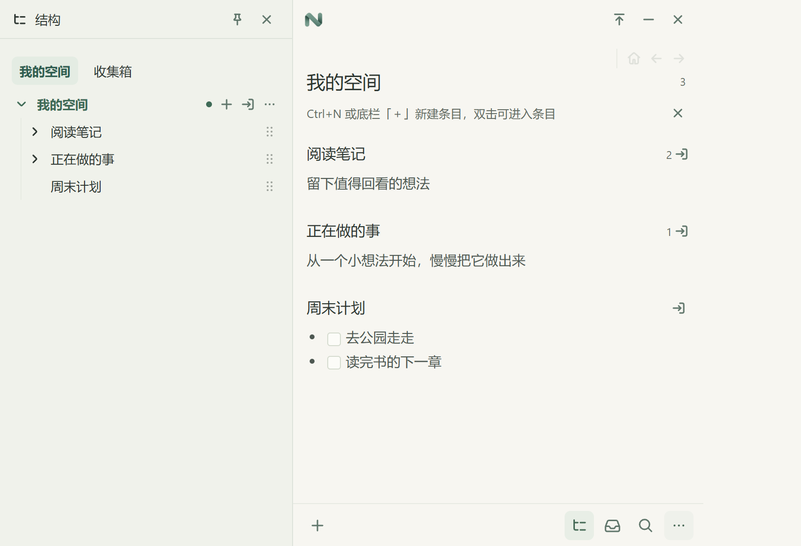

  

<h1 align="center">NEST</h1>

让结构在记录中生长

  Windows 桌面笔记 · 本地保存 · 免费使用

  <a href="https://github.com/Kiteyui/NEST/releases/latest">下载最新正式版</a> ·
  <a href="https://github.com/Kiteyui/NEST/releases">所有版本与预览版</a> ·
  <a href="https://github.com/Kiteyui/NEST/issues">反馈问题</a>

NEST 是一个轻量的桌面笔记空间。先记下眼前的想法，需要时再进入条目、补充内容、整理层级，不必在动笔之前决定它属于哪种文件夹或笔记本

  

*截图由当前界面组件和示例内容生成，实际桌面显示会随系统字体与缩放设置变化*

## 可以怎样使用

- **随手记录**：在当前条目下新建内容，或打开收集面板暂存想法
- **逐层展开**：单击编辑，双击进入；每个条目都可以继续包含子条目
- **按需整理**：打开结构面板浏览、拖动层级，利用搜索找回内容
- **分开保存**：为不同用途选择不同空间，在同一窗口切换
- **留在本地**：笔记保存在你选择的文件夹中，不需要账户

## 下载与开始

当前提供 Windows x64 版本，仍在持续迭代。请以对应 Release 的说明和已知问题为准

| 文件 | 用途 |
| --- | --- |
| `NEST_<版本>_x64-setup.exe` | 安装版，包含 WebView2 离线安装组件 |
| `NEST-<版本>-windows-x64-portable.zip` | 便携版，解压后运行 `NEST.exe`，需要系统已安装 WebView2 |
| `SHA256SUMS.txt` | 下载文件的 SHA-256 校验值 |

第一次打开时，选择一个可写文件夹创建空间，或打开已有空间。不要直接在压缩包内运行程序

详细说明见 [使用指南](docs/usage.md)。如果暂时没有正式版，使用“所有版本与预览版”入口查看可用的测试版本

## 数据与隐私

笔记正文和层级保存在所选空间的 SQLite 数据库中，并非一组独立的 Markdown 文件。Markdown 是正文格式

网页标题读取默认关闭；启用后，程序会请求你输入的网页地址。关闭程序后再备份整个空间文件夹，避免遗漏数据库写入日志

## 反馈

请在 [Issues](https://github.com/Kiteyui/NEST/issues) 中描述操作步骤、版本号和预期结果。截图前请遮盖私人笔记、空间路径等信息，不要上传数据库

## 关于这个仓库

这里用于展示 NEST、提供软件下载和收集反馈，**不是源码仓库**。NEST 目前免费使用，尚未以开源许可证发布源码。第三方组件仍遵循各自许可证，随下载包提供相关声明
