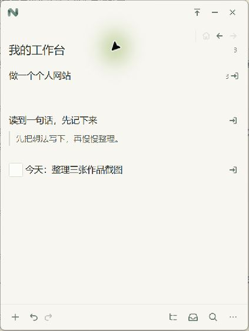
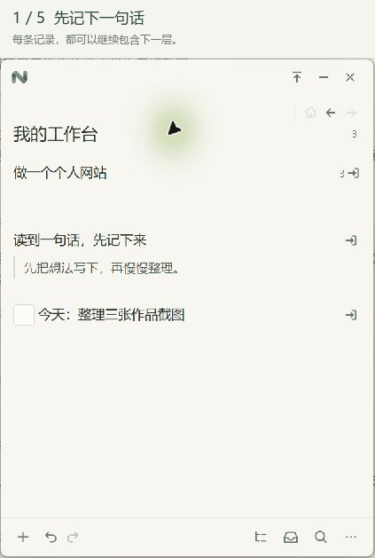
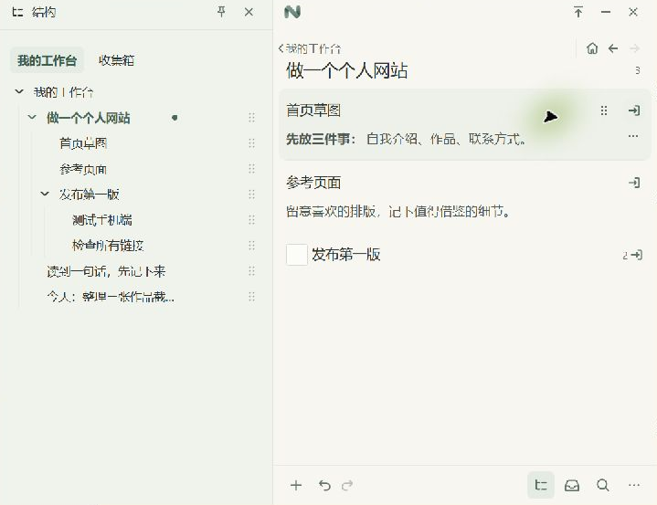
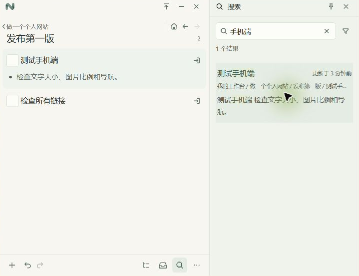
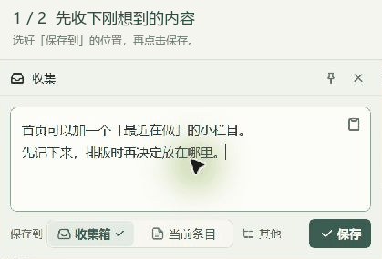
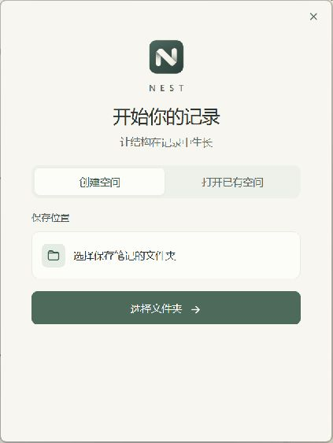

  

<h1 align="center">NEST</h1>

<strong>让结构在记录中生长</strong>

一张随手记录的便签，也是一处可以慢慢展开的思考空间。

Windows · Markdown · 本地保存 · 免费使用

  <a href="https://github.com/Kiteyui/NEST/releases"><strong>下载试用</strong></a> ·
  <a href="docs/usage.md">使用指南</a> ·
  <a href="https://github.com/Kiteyui/NEST/issues">反馈与建议</a>

---

有些想法开始时，只有一句话。一个还没想清楚的计划，一段值得留下的摘录，一件准备动手做的事。

NEST 是一款 Windows 桌面笔记工具。平时，把它当作放在手边的小便签；需要深入时，进入某个条目，继续添加下一层；内容多起来后，再展开结构与搜索。

**先留下眼前的内容，之后再决定，它只是一句话，还是一个项目的开始。**

  

> **预览测试中**：以下截图与步骤动图来自 v0.1.2 的 Windows 桌面实机操作，使用演示空间“我的工作台”。步骤动图按操作顺序展示关键画面。版本仍在迭代，重要内容请保留备份，暂不建议作为唯一存储。

## 写下一条，再慢慢展开

在 NEST 中，一句话、一条待办、一段 Markdown，都是**条目**。每个条目都可以继续包含其他条目。

比如，先写下“做一个个人网站”。有了更多想法后，再进入它，添加“首页草图”“参考页面”“发布第一版”。记录本身就能容纳下一步，不必先决定它应该是一篇笔记，还是一个文件夹。

  

双击未编辑的条目进入，后退返回。每一层只显示它的直接子条目。

| 想做什么 | 怎么操作 |
| --- | --- |
| 写下一条 | 点击底栏 `＋`，或按 `Ctrl+N` |
| 修改内容 | 在笔记区单击条目 |
| 完成编辑 | 默认按 `Enter`；`Shift+Enter` 换行，`Ctrl+Enter` 始终完成 |
| 进入下一层 | 双击未编辑的条目，或点击行末进入图标 |
| 回到刚才的位置 | 点击后退图标 |

已进入编辑的条目中，双击用于选择文字。快捷键和 Enter 行为可以调整，以设置页为准。

## 需要整理时，再展开结构

小窗口里也能新建、编辑和逐层进入，还可以置顶，放在正在阅读或工作的窗口旁边。

需要看清整体时，打开**结构**面板。展开层级、调整顺序，把条目移到合适的位置；整理完后，再收起面板。

  

结构面板用于浏览和整理层级，笔记区用于编辑内容。

## 记得内容，就能找回来

打开**搜索**，输入记得的文字。结果会显示所在路径，帮助你找到当时放下它的位置。单击结果可定位并高亮，双击则进入该条目。

  

## 暂时没想好放在哪，就先收下

打开**收集**面板，写下刚想到的内容，保存到收集箱、当前条目，或另选位置。保存后，可以继续原来的阅读和整理。

  

<a href="assets/readme-20261024/capture.png">查看收集面板静态截图</a>

条目支持 Markdown，重点、待办、引用和代码都能写进内容。一条待办也可以拥有执行步骤，一段阅读记录也可以继续容纳摘录和自己的判断。

## 下载与开始

前往 [Releases](https://github.com/Kiteyui/NEST/releases) 查看可用版本和对应说明。当前面向 Windows x64，按使用环境选择：

| 类型 | 适合的情况 |
| --- | --- |
| 轻量安装版 | 下载体积较小；缺少 WebView2 运行时，需要联网安装 |
| 完整安装版 | 包含 WebView2 离线安装组件，适合安装时不便联网的电脑 |
| 便携版 ZIP | 完整解压后运行，需要系统已安装 WebView2 运行时 |

第一次打开时，选择文件夹创建新空间并命名，或打开已有空间。进入后，点击底栏 `＋` 就能写下第一条。

  

不同用途可以使用不同空间，在同一窗口切换。不要直接在压缩包内运行程序，也不要把发布包解压到笔记数据库文件夹内。

日常操作、空间切换和升级方法见 [使用指南](docs/usage.md)。

## 关于数据，我们说清楚

NEST 不需要账户。笔记正文、层级与空间状态保存在你选择的空间文件夹中。

**Markdown 是内容格式，不代表每个条目都是一个独立的 `.md` 文件。** 当前使用 SQLite 数据库存储，不能把空间文件夹当作由其他文本编辑器直接修改的 Markdown 文件库。

网页标题读取默认关闭。启用后，NEST 会请求你输入的网页地址以读取标题，这项功能需要联网。

**备份前，请先彻底退出 NEST，再复制整个空间文件夹。** 关闭窗口可能只是隐藏到托盘，并不等于退出。升级前同样建议备份，不要用旧版本直接打开新版数据库。详见 [保存与备份](docs/usage.md#保存与备份)。

## 为什么做 NEST

我们想做好一种记录体验：开始时足够简单，深入时也有空间。记录不必都长成一棵大树，有的会成为文章、计划或作品，有的只是让今天的工作顺利一点。NEST 希望为这两种记录都留出位置。

## 欢迎试用，也欢迎告诉我们哪里不顺手

用它整理一个小项目，记录阅读中的问题，或者只留下今天的几件待办。遇到问题时，请告诉我们：原本想做什么，在哪一步停了下来，最后发生了什么。喜欢的细节也欢迎告诉我们。

在 [Issues](https://github.com/Kiteyui/NEST/issues) 提交反馈时，请附上版本号、Windows 版本、缩放比例和复现步骤。分享截图前请遮盖私人内容与路径，**无需上传笔记数据库**。

## 关于这个仓库

本仓库用于介绍 NEST、发布下载包和收集反馈，**不是源码仓库**。

NEST 目前免费使用，尚未以开源许可证发布源码。第三方组件遵循各自许可证，相关声明随下载包提供。
